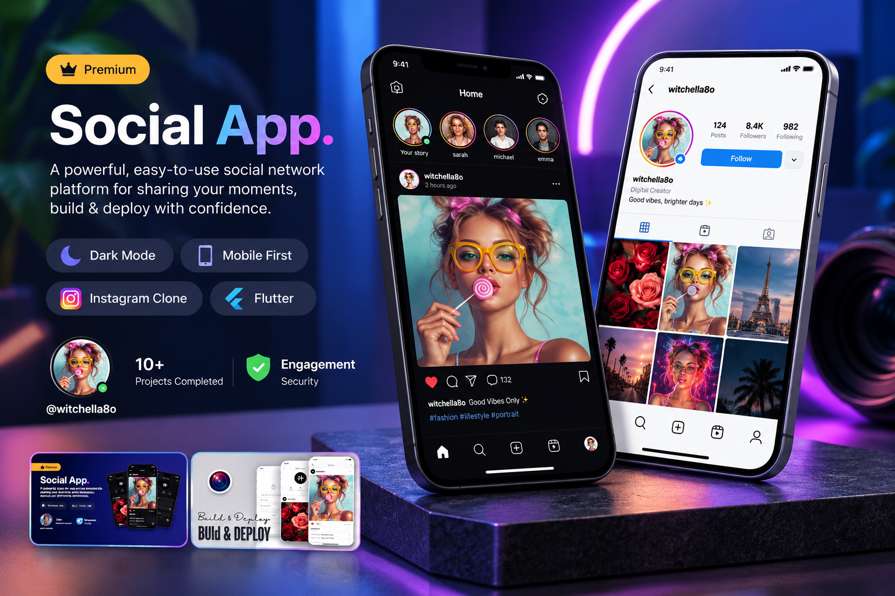

<div align="center">

# 📱 Social Media App

### Flutter • Dart • Supabase • Firebase

A modern social networking application built with
**Flutter, Supabase, and Firebase**, featuring
user authentication, posts, likes, comments,
profiles, search, and real-time updates.


</div>

---

## 📸 Project Preview

<div align="center">

<a href="6010f219-f47b-457d-a908-ad9588b1db2b.png">
  
</a>

</div>

---

## 📖 About the Project

**Social Media App** is a Flutter-based
social networking application designed
to connect users through posts,
interactions, and personal profiles.

The application combines Flutter's
cross-platform UI capabilities with
Supabase and Firebase services.

It demonstrates practical experience
building interactive applications
with authentication, user-generated
content, and real-time functionality.

---

## ✨ Key Features

### 🔐 Authentication & User Accounts

- User registration and login.
- User authentication.
- Account management.
- User profile information.
- Session handling.

### 📝 Posts & Content

- Create and publish posts.
- Display posts in a social feed.
- View user-generated content.
- Manage post information.
- Interactive post interface.

### ❤️ Likes & Comments

- Like posts.
- View post interactions.
- Add comments.
- Display comments.
- Social engagement features.

### 👤 User Profiles

- Personal user profiles.
- Profile information display.
- User-related posts.
- Profile management.
- User account details.

### 🔎 Search & Discovery

- Search functionality.
- Discover users.
- Explore social content.
- Navigate between profiles.

### ☁️ Cloud Storage

- Integration with cloud storage.
- Support for application media assets.
- Media-related backend functionality.

### ⚡ Real-Time Updates

- Real-time data synchronization.
- Dynamic content updates.
- Reactive user interface.
- Backend-driven application updates.

### 🎨 Modern UI/UX

- Clean Flutter interface.
- Social feed layout.
- Reusable UI components.
- Responsive design.
- Intuitive navigation.

---

## 🛠️ Technologies Used

| Technology | Purpose |
|------------|---------|
| Flutter | Cross-platform UI |
| Dart | Application logic |
| Supabase | Backend services |
| Firebase | Cloud services |
| PostgreSQL | Supabase database |
| Cloud Storage | Media management |
| Git | Version control |
| GitHub | Source code hosting |

---

## 🏗️ System Architecture

The application uses Flutter for
the frontend and cloud services
for backend functionality.

```text
           Social Media App
                  |
                  v
             Flutter UI
                  |
                  v
          Application Logic
                  |
         +--------+--------+
         |                 |
         v                 v
      Supabase          Firebase
         |                 |
    +----+----+       Cloud Services
    |         |
    v         v
 Database   Storage
    |
    v
 Users / Posts /
 Likes / Comments
```

The exact responsibilities of Supabase
and Firebase depend on the project's
implementation.

---

## 🔄 Application Workflow

```text
          Open Application
                  |
                  v
           Authentication
                  |
                  v
             Home Feed
                  |
       +----------+----------+
       |          |          |
       v          v          v
     Posts      Search     Profile
       |
       v
  View Content
       |
  +----+----+
  |         |
  v         v
 Likes    Comments
       |
       v
 Updated Social Feed
```

---

## 📱 Main Application Modules

| Module | Description |
|--------|-------------|
| Authentication | Registration and login |
| Home Feed | Display social posts |
| Posts | Create and manage content |
| Likes | Interact with posts |
| Comments | Discuss published content |
| Profiles | View user information |
| Search | Discover users and content |
| Storage | Manage application media |

---

## 🚀 Getting Started

### Prerequisites

Make sure you have installed:

- Flutter SDK
- Dart SDK
- Android Studio or VS Code
- Git
- Supabase project
- Firebase project, if required by the implementation

### 1. Clone the Repository

```bash
git clone <YOUR_SOCIAL_MEDIA_REPOSITORY_URL>
```

Replace the placeholder with your
actual GitHub repository URL.

### 2. Navigate to the Project

```bash
cd <YOUR_PROJECT_FOLDER>
```

### 3. Install Dependencies

```bash
flutter pub get
```

### 4. Configure Supabase

Create a Supabase project and configure
the application with:

- Supabase Project URL.
- Supabase publishable/anon key.
- Required PostgreSQL tables.
- Authentication settings.
- Storage buckets, if used.
- Row Level Security policies.
- Realtime subscriptions, if used.

Ensure your database schema matches
the application's existing models.

Never include a Supabase service-role
key in a Flutter client application.

### 5. Configure Firebase

If Firebase is used in the project,
configure the required Firebase services.

This may include:

- Firebase project setup.
- FlutterFire configuration.
- Required platform configuration files.
- Firebase security rules.
- Enabled Firebase services.

Only enable the services used by
the actual implementation.

### 6. Run the Application

```bash
flutter run
```

The application requires its corresponding
backend configuration to function correctly.

---

## 🔒 Security Considerations

- Use secure authentication workflows.
- Configure Supabase Row Level Security.
- Protect user-generated content.
- Validate database access permissions.
- Apply appropriate storage policies.
- Never expose private server credentials.
- Configure Firebase security rules where required.

---

## 💡 Development Highlights

This project demonstrates experience in:

- Flutter application development.
- Building social networking interfaces.
- Integrating cloud backend services.
- Implementing user authentication.
- Managing user-generated content.
- Creating likes and comments functionality.
- Building profile and search interfaces.
- Handling real-time application updates.
- Organizing backend-driven application data.

---

## 🎯 Project Goals

- Build an interactive social networking app.
- Connect users through shared content.
- Provide intuitive post interactions.
- Implement authentication and profiles.
- Explore real-time cloud technologies.
- Deliver a responsive Flutter experience.

---

## 🔮 Potential Future Improvements

- Push notifications.
- Direct messaging.
- Follow and unfollow functionality.
- Advanced content discovery.
- Post sharing.
- Media uploads and video support.
- Content moderation tools.
- Dark mode.
- Improved search and recommendations.

---

## 👨‍💻 Developer

**Ahmed Jaber Ahmed**

Flutter Developer | Mobile App Developer

B.Sc. Computer Science & Artificial Intelligence

📍 Cairo, Egypt

- [GitHub](https://github.com/AhmedJaberAhmed)
- [Portfolio](https://ahmedjaberahmed.github.io/Jaber-website/)
- [LinkedIn](https://www.linkedin.com/in/ahmedjaberahmed/)

---

<div align="center">

### ⭐ Support the Project

If you find this project interesting,
consider giving it a star!

**Built with Flutter 💙**

</div>
